# 公開台本平台 (`write_project`)

目前版本為 **v0.7.6**（2026-11-26）。[查看版本更新紀錄](./CHANGELOG.md#076---2026-11-26)

本專案是一個台本創作、發布與公開閱讀平台。公開網站與工作室分別由兩個前端提供：

- `apps/studio/`：Vite 工作室/editor。負責創作、發布工作室、後台管理、匯入匯出與編輯器預覽。
- `apps/public/`：Next.js 公開站原始碼。正式公開入口採 Cloudflare Pages 靜態匯出，瀏覽器向 Tunnel 主 API 取得即時公開資料，失聯時使用 D1／R2 唯讀備援。SEO HTML、metadata 與 sitemap 是建置快照；正式環境不再啟動 Next server，公開 JSON 與封面統一由 FastAPI 提供。Next.js 保留為 Pages 建置工具與本機開發服務。

共享的解析、渲染、公開 UI、媒體裁切與 PDF 匯出能力放在 `packages/*`，避免 Vite 與 Next 重複實作。

## 正式架構總覽

```mermaid
flowchart TB
  Reader[公開站讀者] --> Pages[Cloudflare Pages<br/>靜態 HTML、SEO、前端程式]
  Reader -->|瀏覽器即時 API／媒體| Tunnel[Cloudflare Tunnel]
  Editor[工作室使用者] --> Tunnel
  Tunnel --> Nginx[正式 Mac：Nginx]
  Nginx --> Studio[Vite 工作室靜態檔]
  Nginx --> API[FastAPI<br/>業務、公開 API、媒體與縮圖]
  API --> DB[(PostgreSQL)]
  API --> Media[本機上傳媒體]
  Reader -. 公開唯讀備援 .-> Cloud[Worker＋D1／R2]
  API -->|每 15 分鐘同步| Cloud
  DB --> Backup[每日 04:00 台北時間備份]
  Media --> Backup
  Backup --> Copies[本機 14 天＋Horcrux 180 天]
  Monitor[每 5 分鐘監控] -. 檢查 .-> API
  Monitor -. 檢查 .-> Pages
```



- **程式部署**：PR 合併 main → 同一 SHA 的兩組 CI 全部成功 → Mac runner 建置、驗證候選並切換 API／Nginx → 發布 Pages → 線上驗證、保留回滾版。
- **內容更新**：工作室先寫入 PostgreSQL；瀏覽器依快取與刷新機制取得新資料。GitHub Actions 約每 15 分鐘檢查內容，用已部署版本建置、驗證並更新 Pages 靜態快照。
- **維運**：本機監控每 5 分鐘、D1／R2 同步每 15 分鐘、每日 04:00 備份。監控與備份排程已啟用，Horcrux 副本已通過實際隔離還原。
- **邊界**：正式環境沒有 Next server／ISR；D1／R2 僅備援公開讀取。Mac 仍是寫入單點，Horcrux 是外接碟副本，並非異地備份。

完整服務圖、部署／內容流程、監控範圍、備份限制與驗收證據見 [正式環境整體架構](./docs/architecture/production-architecture.md)。

## 目前產品面

- 公開站：首頁作品目錄、作者／組織／系列／標籤頁、公開閱讀器、音聲作品、可獨立分享的 Demo 詳情、資源名錄及說明頁。
- 製作資源：聲演、後製、美術與錄音室共用名錄與詳情頁，呈現聯絡方式、參與作品及作品連結；參與作品可包含站外作品。
- 公開投稿：台本、音聲作品、Demo 與製作資源由訪客提交，經管理員審核後公開；已刊登資源也可提交補充或修正。
- 外部公開台本：管理員可只匯入外部作品的標題、摘要、封面、作者與分類，完整內容仍由原網站提供。
- 閱讀器：marker-driven presentation renderer，支援一般閱讀、系列章節導航、marker 顯示控制、閱讀偏好、分享與 PDF 匯出。
- 工作室：管理作品、系列、作者及組織，編輯中繼資料與標記主題，同時預覽網頁閱讀與 Word 成品，並依標記規則匯出製作台本。
- 後端：FastAPI API、權限與資料持久化；正式資料庫以 PostgreSQL 為主。

## 技術棧

| 層 | 技術 |
|---|---|
| 工作室前端 | Vite, React 19, TypeScript, React Router |
| 公開站 | Next.js 16 App Router, React 19, TypeScript；Pages 靜態匯出；正式 API／媒體由 FastAPI 提供 |
| 共享套件 | npm workspaces under `packages/*` |
| 後端 | FastAPI, SQLAlchemy |
| DB | 正式 PostgreSQL；SQLite 用於測試、遷移及獨立爬蟲狀態 |
| 測試 | Vitest, Playwright, Pytest |
| 樣式 | Tailwind CSS, CSS variables, shared marker theme tokens |

## 專案結構

```text
apps/public/              Next.js public frontend
  app/                    public routes, server data loading, metadata
  components/             public app adapters and shell actions
  lib/                    API/BFF adapters, SEO models, public projections

apps/studio/              Vite studio/editor frontend
  index.html              Vite entry point
  public/                 static assets served by Studio
  src/                    editor, dashboard, reader preview, and API adapters

packages/
  script-engine/          marker config normalization, parser, AST, render model
  script-reader-renderer/ React renderers and marker-driven presentation layout
  script-reader-ui/       reader state, toolbar primitives, reading preferences
  script-theme/           shared marker color CSS tokens
  public-ui/              router-neutral public domain models and UI components
  reader-export/          PDF/print export, metadata projection, print HTML
  media-crop/             media crop encode/decode/style helpers
  browser-download/       browser download primitives

server/                   FastAPI backend
docs/                     architecture, SEO, reader, security, migration notes
scripts/                  development and maintenance scripts
config/                   Studio build, styling and repository test config
```

## 公開站路由

正式公開頁由 Pages 靜態匯出，HTML、metadata 與 sitemap 隨發布快照更新；頁面載入後可向公開 API 讀取即時資料。Next server mode 的 ISR／revalidate 設定不代表正式站更新時程。

| Route | 用途 |
|---|---|
| `/` | 首頁 gallery、hero、作品／作者／組織目錄 |
| `/read/[id]` | 公開閱讀器 |
| `/author/[id]`、`/org/[id]` | 作者／組織頁 |
| `/author/external/[name]`、`/org/external/[name]` | 外部作者／組織頁 |
| `/series/[name]`、`/tag/[name]` | 系列／標籤集合頁 |
| `/authors`、`/audio-works`、`/demos`、`/resources` | 公開名錄 |
| `/resources/[id]` | 製作資源詳情與參與作品 |
| `/about`、`/help`、`/license`、`/privacy`、`/terms` | 公開資訊頁 |

`apps/public/app/api/*` 的 Next BFF 僅供 server mode／開發相容；正式瀏覽器使用建置時設定的主／備援 API origins。正式 API 與媒體實作位於 FastAPI。工作室 Demo 管理頁使用 `/studio/demos`；公開 `/demos` 由 Pages 提供，原始碼位於 `apps/public`。

## 架構邊界

- `apps/public` owns public routes, build-time metadata, public URL behavior, and browser primary/fallback adapters. Production APIs and media belong to FastAPI.
- `apps/studio` owns studio/editor workflows. Vite public-looking modules that remain are editor preview code or compatibility facades.
- `packages/script-engine` is the single source for parser/AST/render model logic.
- `packages/script-reader-renderer` owns canonical script rendering and marker-driven presentation layout. Legacy `v2` names are compatibility aliases.
- `packages/public-ui` owns router-neutral public models and UI components. It exports a client barrel (`index.ts`) and a server-safe barrel (`server.ts`).
- `packages/reader-export` owns PDF/print export and public metadata projection for exported documents.

See [docs/architecture/frontend-boundaries.md](./docs/architecture/frontend-boundaries.md) for the full boundary rules.

## 快速開始

### 1. 安裝依賴

```bash
npm ci
```

### 2. 啟動 Vite 工作室/editor

```bash
npm run dev
```

### 3. 啟動 Next 公開站

```bash
npm run dev -w apps/public
```

### 4. 啟動後端（本機）

```bash
cd server
pip install -r requirements.txt
uvicorn main:app --reload --port 1091
```

## 常用指令

```bash
npm run typecheck        # root TypeScript check
npm run test             # Vitest multi-project suite
npm run build            # Vite studio build
npm run build:public     # Next public build
npm run test:e2e         # Playwright E2E
python3 scripts/checks/check-docs.py  # Markdown 本機連結與程式碼區塊閉合檢查
```

後端測試請在 `server/` 內使用 Pytest。

只修改 Markdown（包含子目錄的 README）時，PR 與 main push 會執行 `Documentation checks`，不會啟動兩組程式 CI 或正式部署。文件與程式／設定混合修改仍依程式路徑執行對應檢查。文件提交可能讓 main 領先正式版本；若部署中的 CI 核准 SHA 之後只有一般 Markdown 更新，原部署會繼續使用該 SHA，並在入口切換前再次檢查差異；後續含程式或設定的提交仍會阻擋舊候選部署。內容刷新繼續使用已部署 SHA，詳見[持續部署的 CI gate](./docs/engineering/continuous-deployment.md)。

## 部署

- 正式公開入口為 Cloudflare Pages 靜態檔；工作室與主 API 經 Tunnel 連到本機入口。D1／R2 是公開資料與媒體唯讀備援，不接管寫入。
- 網站發布以 [持續部署與發布程序](./docs/engineering/continuous-deployment.md) 為準；`scripts/release/release.sh` 協調建置、獨立 schema 檢查、候選準備、入口切換、Pages 上傳及驗證。
- `scripts/release/site-release.py` 管理網站候選與回滾，不停止 PostgreSQL；API／入口回滾與 Pages 靜態檔回滾分開，資料變更不隨之回復。
- `deploy/compose.prod.yml` 是本機服務設定基線，並非目前線上 release tag 的證據。Pages 資源與快照限制見 [正式公開站操作](./docs/engineering/public-pages-production.md)。

## 主要文件入口

- [正式環境整體架構](./docs/architecture/production-architecture.md)
- [監控操作](./docs/engineering/production-monitoring.md)
- [備份與還原](./docs/engineering/backup-restore.md)
- [Changelog](./CHANGELOG.md)
- [Frontend Runtime Boundaries](./docs/architecture/frontend-boundaries.md)
- [Public Homepage Architecture](./docs/architecture/public-homepage-architecture.md)
- [Read Page SEO/UX Architecture](./docs/architecture/read-page-seo-ux-architecture.md)
- [Read Page Download Architecture](./docs/architecture/read-page-download-architecture.md)
- [Read Page Export Metadata Projection](./docs/architecture/read-page-export-metadata-projection.md)
- [SEO Google Content Visibility Contract](./docs/architecture/seo-google-content-visibility-contract.md)
- [Security Protection](./docs/architecture/security-protection.md)
- [內容管理本機 MCP](./docs/architecture/local-external-script-mcp.md)
- [外部公開台本匯入流程](./docs/product/external-public-script-import.md)

## 環境變數與認證

- Vite studio API base: `VITE_API_URL`，未設時預設 `/api`。
- Next server／Pages build backend base: `BACKEND_API_URL`；Pages 瀏覽器主／備援由 `NEXT_PUBLIC_API_ORIGIN`／`NEXT_PUBLIC_FALLBACK_API_ORIGIN` 決定，媒體另有主／備援 origins（見正式公開站操作）。
- Public canonical base: `NEXT_PUBLIC_BASE_URL`。
- `FEEDBACK_NOTIFICATION_EMAIL`：公開頁回報／上架申請的通知收件人，預設為 `silence0603@gmail.com`。
- `SMTP_HOST` / `SMTP_PORT` / `SMTP_USERNAME` / `SMTP_PASSWORD`：寄信服務設定；Gmail 請使用應用程式密碼，不要使用一般登入密碼。
- `SMTP_FROM`：寄件地址，未設定時使用 `SMTP_USERNAME`。
- `SMTP_USE_TLS` / `SMTP_USE_SSL`：SMTP 加密方式，預設使用 STARTTLS。
- 正式部署由 Nginx 反代 backend API。
- 認證使用 `Authorization: Bearer <Firebase token>`。
- 本機測試模式可使用 `X-User-ID`，詳見後端認證文件。

## 長期原則

- 公開頁功能以 Next.js 為準；Vite 不再承擔 public runtime。
- 編輯器與工作室仍由 Vite 承擔。
- 解析、marker theme、reader renderer、public gallery model、PDF export 必須放在 shared packages，不允許兩邊複製邏輯。
- 公開頁路由與 SEO metadata 放在 `apps/public`；正式 API／媒體放在 FastAPI。Next BFF 僅保留開發相容用途。
- 新增 reader/public 功能前，先確認應放在 app adapter、public domain model、renderer package，或 engine package。
