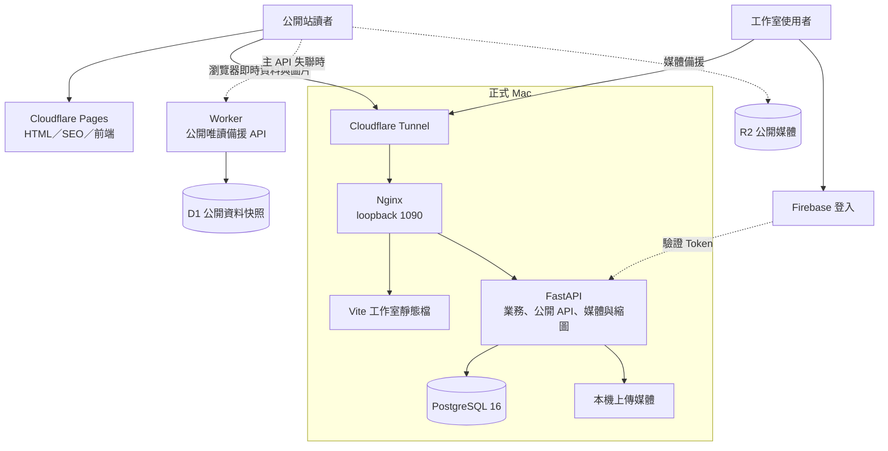
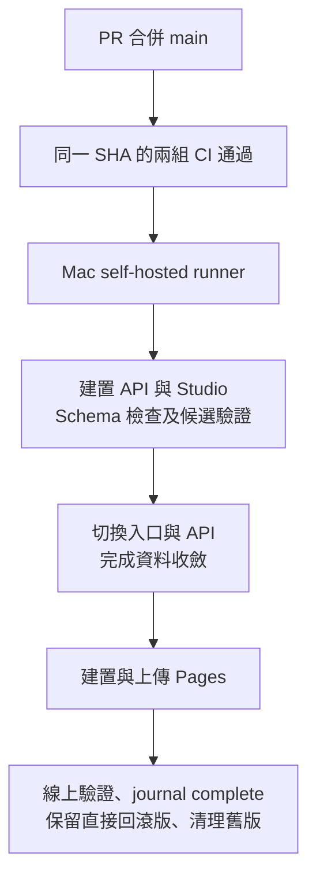
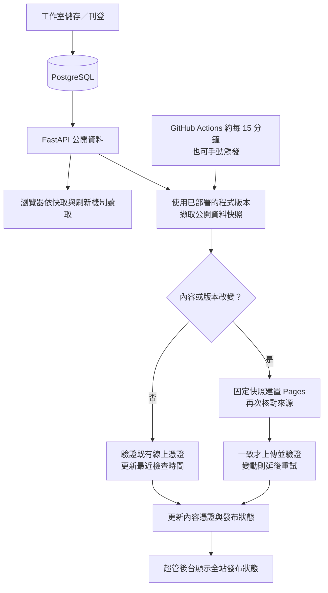
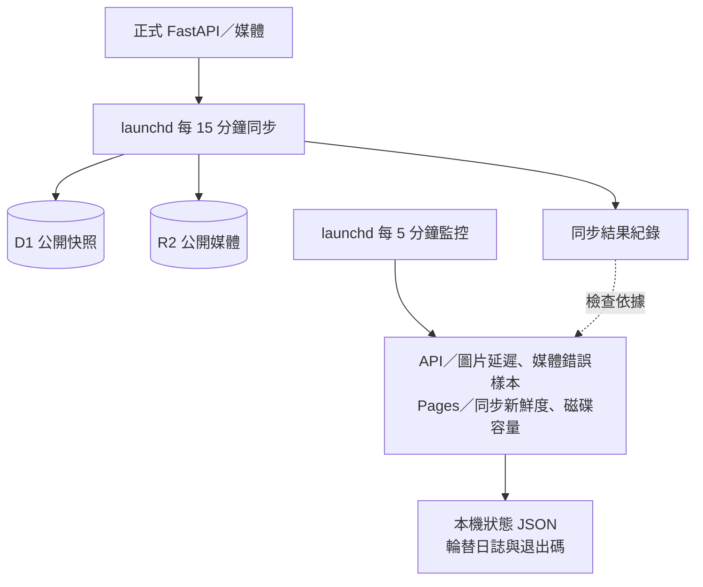
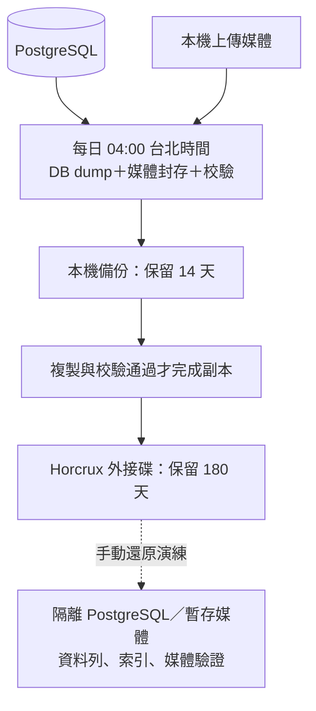

# 正式環境整體架構

核對日期：2026-11-16。本頁以 PR #48 精簡與 PR #49 修正後、已驗收的 `6b32f07` 為架構基準；不是待部署方案。後續文件提交可能使用較新的版本，實際線上 SHA 以 live ingress、完整發布 journal 及線上內容憑證為準。

## 服務如何運作

公開閱讀由 Cloudflare Pages 提供靜態 HTML、SEO、sitemap 與前端程式；瀏覽器再向 FastAPI 讀取即時資料。工作室由本機 Nginx 提供 Vite 靜態檔，編輯、登入驗證與資料寫入交給 FastAPI。PostgreSQL 是正式資料來源，上傳媒體存於本機資料目錄。

| 入口 | 承擔的工作 |
|---|---|
| `open-scripts.shawnup.com` | Cloudflare Pages 公開站；瀏覽器向主／備援 API 取資料 |
| `studio-open-scripts.shawnup.com` | Tunnel → Nginx → Vite 工作室；業務請求送 FastAPI |
| `api-open-scripts.shawnup.com` | Tunnel → Nginx → FastAPI 的 API／媒體入口 |
| `fallback-open-scripts.shawnup.com` | Worker 從 D1 供應公開資料備援 |
| `media-open-scripts.shawnup.com` | R2 公開媒體備援 |

網站的正式容器核心為 Nginx、FastAPI 與 PostgreSQL。Next.js 保留為公開站的建置工具及本機開發服務；**正式環境沒有 Next server，也沒有執行期 ISR**。直接回滾版本可能保留上一版 API 容器，不代表第二套業務系統。API／資料庫不直接發布主機對外連接埠。

## 程式部署與內容更新

這是兩條不同的流程：修改程式需要 main 的 CI／CD；管理員儲存或刊登內容不需要提交程式，但 Pages 的靜態快照仍要重新建置。

**程式發布**

**內容發布**

- 兩組程式 CI 為 `Public read and security contracts` 與 `Submission workflows`。CD 與內容刷新共用 `production-deploy` concurrency；仍須確認 journal 完成，不能只看某個提前等待 CI 的部署 job 顯示成功。
- 內容刷新 cron 為每小時第 7、22、37、52 分鐘。GitHub 排程可能延後，另需建置時間；**不是儲存後立即推送，也不是逐筆發布完成通知**。
- 頁面資料儲存成功、瀏覽器讀到新資料、靜態 HTML／SEO 上線是不同時點。後台顯示的是全站最近驗證結果，不能據此保證剛儲存的某一筆已包含在 Pages。
- 程式 CD 與內容刷新都將 commit 與內容 digest 寫入 Pages 的 `content-version.json`。發布工具核對正式網址的憑證與代表頁面後，才更新本機內容刷新紀錄。
- 網站入口／API 回滾與 Pages 回滾分開；資料庫遷移及業務資料不隨程式回滾自動復原。

詳細操作見 [持續部署](../engineering/continuous-deployment.md)、[Pages](../engineering/public-pages-production.md) 及 [發布狀態](../engineering/publication-status.md)。

## 同步、監控與備份

**公開備援同步與監控**

**資料備份與還原**

| 工作 | 執行方式 | 現行規則 |
|---|---|---|
| 程式部署 | GitHub CI → Mac runner | main 的指定 CI 全部成功後自動部署 |
| Pages 內容刷新 | GitHub Actions | 約每 15 分鐘，可手動觸發；使用已完整部署的程式版本 |
| D1／R2 同步 | `com.shawnup.write-project-public-sync-prod` | 每 900 秒；與 Pages 刷新獨立 |
| 監控 | `com.shawnup.write-project-monitor` | 每 300 秒；健康／異常／未知分開記錄 |
| 備份 | `com.shawnup.write-project-backup` | 每日 04:00，Asia/Taipei；本機＋Horcrux |
| 還原演練 | `backup-bundle.py drill` | 手動隔離驗證；未新增定期自動還原排程 |

監控涵蓋 API 與圖片探測延遲、有限範圍 Nginx 媒體錯誤樣本、Pages／同步新鮮度與磁碟容量。樣本包含合成探測請求，不是完整流量統計；同步紀錄也不是獨立的 D1／R2 全量可用性稽核。現行輸出為本機 JSON、輪替日誌與退出碼，未新增 Email／Slack 告警服務。

維運工具放在獨立的版本目錄，包含固定版本的 Wrangler 與安裝紀錄，不依賴可被刪除的開發 worktree。備份工具位於 `$HOME/bin`，LaunchAgents 位於 `$HOME/Library/LaunchAgents`；詳細路徑與回復程序見 [監控操作](../engineering/production-monitoring.md) 與 [備份還原](../engineering/backup-restore.md)。

## 驗收與限制

2026-11-16 驗收已確認：

- [正式部署成功](https://github.com/Shawn-csy/write_project/actions/runs/43798799241)，[內容刷新成功](https://github.com/Shawn-csy/write_project/actions/runs/43799579143)，線上憑證與 `6b32f07` 一致。
- 監控有實際定時執行成功的證據；最終六項檢查正常。媒體同步檢查 153 個物件、跳過 0 個。
- launchd 實際備份成功；從 Horcrux 副本隔離還原 40 張資料表、2,375 筆資料及 208 個媒體檔，資料列、索引與媒體驗證通過。

Mac 仍承擔業務寫入、PostgreSQL、主媒體、runner 與本機排程；停機時 Pages 及已同步的公開唯讀備援可繼續供應其已有內容，但工作室與寫入不會自動接管。D1／R2 不是完整資料庫備份。

Horcrux 是外接碟副本，並非異地備份。資料庫 dump 與媒體封存先後執行，不是跨資源原子快照；需要嚴格一致的還原點時，須安排暫停寫入。監控本身位於同一台 Mac，不能把它當作主機斷電時仍會主動通知的獨立外部監控。

外部台本爬蟲仍是獨立 CLI，支援範圍與候選審核流程見 [爬蟲文件](../engineering/external-script-crawler.md)；沒有因本次部署啟用爬蟲排程或自動刊登。
