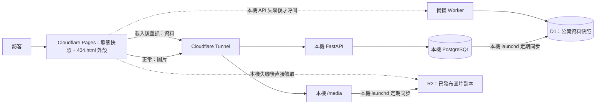

# Cloudflare 公開站與本機工作室的部署方向

狀態：preview Pages 使用獨立 Dev API（Tunnel → 8891），Dev Postgres/媒體由正式資料複製；fallback Worker/D1、R2 和每 15 分鐘同步已啟用。preview 自訂網域已啟用；正式環境尚未切換，自動 Pages 重新部署（SEO）尚未設定
最後更新：2026-10-27

## 目標

公開站部署到 Cloudflare Pages；寫作工作室和完整資料庫繼續留在本機。正常時，公開站的資料與圖片優先讀本機服務，透過 Cloudflare Tunnel 對外提供。只有本機服務失聯時，公開站才改讀雲端備援：公開資料由 Worker 查 D1，圖片由瀏覽器直接讀 R2。

這是「本機為主、雲端唯讀備援」的架構，不是把工作室或完整資料庫搬上雲。

## 混合架構：靜態外殼加瀏覽器即時資料

Pages 上的頁面是**建置時產生的快照**，只負責「第一眼」和搜尋引擎可讀的 HTML。內容是否最新，由瀏覽器載入後向 API 補抓決定。因此後台改動**不需要為了讓訪客看到而重新部署**。

| 項目 | 由什麼決定 | 後台改動後 |
|---|---|---|
| 閱讀頁內文、標題、封面、標籤（已建置的作品） | 瀏覽器載入後重抓，內容不同就換掉快照 | 立即生效，不必部署 |
| 新發布的作品網址 `/read/<id>` | `404.html` 外殼在瀏覽器載入並解析該作品 | 立即可開，不必部署 |
| 首頁作品清單、橫幅、品牌區塊 | 瀏覽器載入後重抓 `/api/public-bundle` | 立即生效，不必部署 |
| 已下架的作品 | 重抓回 404，閱讀頁改顯示 404 | 立即生效 |
| 瀏覽次數、按讚 | 一律即時打本機 API | 即時 |
| 作者、組織、標籤、系列、外部作者／組織頁 | 瀏覽器載入後重抓（作者與組織各抓自己的資料，其餘由 bundle 推導） | 立即生效，不必部署 |
| 建置後才出現的作者、標籤、系列 | `404.html` 外殼依網址載入 | 立即可開，不必部署 |
| `<title>`、描述、分享卡片、sitemap、JSON-LD | 建置時寫入 | 需要重新部署（SEO 用） |

所以重新部署從「讓新內容可見的必要條件」變成「讓搜尋引擎與分享預覽看到新內容」。新作品在重新部署前可以開啟，但它的網址由 `404.html` 提供，HTTP 狀態是 404，搜尋引擎不會收錄，分享預覽也讀不到標題。

重抓的共用邏輯：`lib/useLiveData.ts`（先顯示快照，資料不同才換；重抓失敗保留快照；回 404 或資料為空則顯示 404）、`lib/entityModels.ts`（伺服器建置與瀏覽器共用的純函式，確保兩邊算出同樣的內容）、`components/LiveEntityPages.tsx`（各頁的即時版本與網址分派）。

### 為什麼未建置的網址用 `404.html`，不用 `_redirects`

Pages 的 `_redirects` 不論是否已有對應的靜態檔，規則都會生效（Cloudflare 文件：「Redirects are always followed, regardless of whether or not an asset matches」）。若用 `/read/* /shell 200` 導向外殼，連已預先產生的閱讀頁也會被蓋掉，等於放棄預先產生的 HTML。

Pages 對沒有對應檔案的網址會回傳根目錄的 `404.html`（狀態 404）。因此：

1. `app/not-found.tsx` 在靜態建置中成為 `404.html`，內容是一個客戶端元件。
2. 載入後它讀取 `window.location.pathname`：符合 `/read/<id>` 就渲染 `LiveReader` 載入該作品；符合 `/author/`、`/org/`、`/tag/`、`/series/`（含外部作者、外部組織）就渲染對應的即時頁面；其他網址顯示正常的 404 頁。
3. 已預先產生的頁面完全不受影響，仍以 200 回傳靜態 HTML。

代價是新作品的首次載入狀態碼為 404。這與「新作品要等下次建置才進搜尋引擎」的取捨一致。建置腳本會檢查 `out/404.html` 存在，缺少時直接失敗。

## 服務與資料責任

| 元件 | 職責 | 正常路徑 | 本機故障時 |
|---|---|---|---|
| Cloudflare Pages | 提供公開站的靜態前端檔案與 `404.html` 外殼 | 一律由 Pages 提供 | 繼續提供 |
| 本機 FastAPI + PostgreSQL | 完整資料主庫、工作室 API、公開資料主讀取端 | 工作室和公開站經 Tunnel 使用 | 工作室停止；公開站改讀 D1 備援 |
| Cloudflare D1 | 已發布公開內容的唯讀快照 | 不承接一般瀏覽讀取 | Worker 查詢最近一次成功同步的資料 |
| 本機 `/media` | 圖片主讀取端 | 瀏覽器經 Tunnel 直接讀取 | 圖片改讀 R2 副本 |
| Cloudflare R2 | 已發布圖片的雲端副本 | 不承接一般圖片讀取 | 瀏覽器直接讀取，不經 Worker |
| Cloudflare Worker（API） | 只處理 API：D1 備援讀取；預覽期可轉送到執行中的後端 | 不在一般讀取路徑上 | 僅在前端切到備援時被呼叫 |

Worker **完全不處理圖片**。預覽版 Worker 先前代理 `/media` 並改寫回應中的圖片網址，已移除，改由瀏覽器依下列規則決定圖片來源。

## 請求路徑



### 資料讀取與切換（`lib/liveApi.ts`）

- 讀取先打主要 API（Tunnel）。逾時（4 秒）、連線失敗或回傳 5xx 才切到備援 API。404、驗證錯誤等 4xx 是正常答案，不切換。
- 切換後 60 秒內直接讀備援，不再等主要 API 逾時；結果存在 `sessionStorage`，換頁不必重新等待。冷卻結束後第一次請求會重試主要 API，恢復後自動切回。
- 備援回應帶 `X-Data-Synced-At`，前端保存在 `liveApi.getStatus().syncedAt`，供顯示資料新鮮度（尚未做畫面提示）。
- 寫入（瀏覽次數、按讚、意見回饋、條款同意）與讀者專屬的讀取（按讚狀態）只送主要 API，主要 API 失聯時直接略過，不送備援。
- API 回應中的 `/media/...` 在瀏覽器端改寫成絕對網址：主要 API 的資料指向本機媒體網域，備援 API 的資料指向 R2，與建置時的改寫一致。

### 圖片讀取與切換

- 靜態建置沒有伺服器端圖片代理，`/media/...` 由瀏覽器直接讀媒體網域（預設為主要 API 網域）。
- `MediaFallbackBridge` 在文件層級用捕捉階段監聽圖片錯誤：媒體網域上的圖片載入失敗時，改用 R2 的同一個 key 重試一次（`<R2 網域>/media/<key>`）。共用 UI 套件使用原生 ``，所以在文件層處理，不逐一修改元件。
- 每張圖只重試一次，兩邊都沒有時不會無限重試。

## 環境變數（靜態建置）

| 變數 | 用途 |
|---|---|
| `NEXT_PUBLIC_DEPLOY_ENV` | 靜態建置環境標記；`build:pages-preview` 固定為 `development`，`build:pages` 固定為 `production`，錯配時建置失敗 |
| `NEXT_PUBLIC_API_ORIGIN`（必填） | 主要 API 網域（Dev：8891 API Tunnel；正式：正式 API 網域） |
| `NEXT_PUBLIC_FALLBACK_API_ORIGIN` | 備援 API（Worker＋D1）網域；Dev build 必填 |
| `NEXT_PUBLIC_MEDIA_ORIGIN` | 本機媒體網域；未設定時沿用主要 API 網域 |
| `NEXT_PUBLIC_MEDIA_FALLBACK_ORIGIN` | R2 公開網域；Dev build 必填 |
| `NEXT_PUBLIC_STUDIO_ORIGIN` | 「進入工作室」連結的網域（Dev：獨立 Dev Studio；正式：正式工作室） |
| `BACKEND_API_URL` | 建置時抓資料的來源（見下方「建置來源」） |
| `ALLOW_EMPTY_PUBLIC_BUILD=1` | 允許資料為空時仍建置；預設不允許 |

建置指令：`npm run build:pages`（正式）、`npm run build:pages-preview`（加 `noindex`）。

## 建置來源與防空站

- 靜態建置抓不到資料時一律讓建置失敗，不容錯成空頁：首頁在靜態建置下不再退回空清單，`generateStaticParams` 取得的作品數為 0 也會失敗。目的是避免把空站部署上線（對照 2026-08-20 的事故）。
- 建置時抓資料的來源是 `BACKEND_API_URL`；未設定時沿用主要 API origin。Dev build 會由 8891 API Tunnel 取資料，不會回頭抓正式 API。

## D1／R2 同步

preview 同步由本機 Wrangler 指令執行：

```bash
PUBLIC_SYNC_API_ORIGIN=http://127.0.0.1:8891 \
PUBLIC_SYNC_MEDIA_ORIGIN=http://127.0.0.1:8891 \
PUBLIC_SYNC_R2_PUBLIC_ORIGIN=https://pub-37c286fc2f9143a69bfbe1f784d95880.r2.dev \
npm run sync:public-preview -w apps/public
```

同步會抓公開 bundle、作品、作者、組織、條款與主題路由，並收集這些回應引用的 `/media/` 檔案和外部作品封面。圖片先寫入 R2；D1 的新快照完整寫入後才切換作用中的 generation。舊 generation 在切換成功後清除，因此中斷同步不會讓 Worker 讀到半份資料。D1 內的回應以 gzip 編碼保存，Worker 回應時還原成原 API 的內容型別。

macOS LaunchAgent `com.shawnup.write-project-public-sync` 已安裝，每 900 秒執行一次，登入時也會立即執行。它只讀取公開 API，不會把草稿、帳號、認證資料或內部設定送到 Cloudflare。Cloudflare 憑證只由本機 Wrangler 授權讀取，不放進瀏覽器。排程定期比對公開快照；內容未變時略過 D1/R2 寫入，只有瀏覽／按讚計數變動時更新 D1、不重傳圖片。

需要立即同步時，執行上方的手動同步指令。

LaunchAgent 設定檔在 `scripts/com.shawnup.write-project-public-sync.plist`；執行記錄寫入 `~/Library/Logs/write-project-public-sync/`。排程依賴這台 Mac 登入、網路可用、Wrangler 授權有效及本機 API 可連線；電腦休眠或登出期間不會即時同步，恢復登入與網路後的下一輪才會比對。`X-Data-Synced-At` 是 D1 快照最後更新時間；內容未變的檢查不會推進這個時間。

同步順序固定為：先把公開媒體上傳 R2，再切換 D1 快照。已發布台本被編輯、改封面、改作者頭像、改系列名或改橫幅後，排程會在下一輪檢查並同步；如需立即更新，可手動執行上方指令。

最近一次 preview D1 更新：2026-10-27 09:47:47 UTC，34 個 API 快照；當時 Dev bundle 有 9 個 scripts、4 個 personas、1 個 organization、110 個 external public scripts。後續排程檢查發現快照未變，因此略過 D1/R2 寫入。外部封面與已缺失的本機媒體引用有部分無法同步。

### D1 資料形狀

D1 存的是「公開 API 的回答」，不是重新設計一套關聯式 schema（見 `apps/public/worker/schema.sql`）：每筆 generation 的 `public_snapshot` 以請求路徑加查詢字串為 key，回應 gzip 後存放；Worker 解壓後仍回傳原 API 格式。同步要列舉公開站會用到的路徑，包括 bundle、personas、organizations、terms-config、themes、作品詳情/raw 與作者／組織作品清單。

D1 是公開資料讀取副本，不是本機 PostgreSQL 的完整備份。D1 最多只能提供最後一次成功同步的公開內容；它不包含未發布草稿，也不能用來還原工作室。

### 自動重新部署（待實作）

發布後呼叫 Pages 的 deploy hook 觸發建置，讓新作品取得完整 HTML 與 sitemap 項目。建議延遲約 5 分鐘合併連續發布。順序必須是：先同步 R2 與 D1，再觸發建置。建置結果只影響 SEO 與分享預覽，不影響訪客能否看到內容。

## 圖片方向

- 資料庫保存圖片 key 或 URL；圖片二進位檔放在 R2，不放 D1。
- 已發布圖片才同步至 R2；草稿圖片可先留在本機。
- R2 以獨立的公開媒體網域提供讀取，且由瀏覽器直接載入，不經 Worker。R2 的 key 與本機 `/media/` 路徑一致。
- 圖片 key 應能穩定對應；建議使用版本化或內容雜湊 key，避免更新圖片後遭舊快取遮蔽。
- 靜態建置失去伺服器端縮圖（原本 `?w=` 的 sharp 縮放）。若需要縮圖，之後可考慮同步時預先產生多種尺寸，或使用 Cloudflare Images。

## 瀏覽次數

瀏覽次數是唯一已知的公開寫入操作。正常時沿用本機 API 更新計數。**備援期間暫停計數**：寫入只送主要 API，失聯時略過（已實作）。這避免本機資料庫與 D1 同時更新同一個計數欄位。若日後要在備援期間也計數，需在 D1 記錄事件，恢復後再合併。

## 後端整個離線時，原生台本會怎樣

preview 已配置 Dev API、API 備援 Worker／D1 和媒體 R2。下表為預期行為；已實際停止獨立的 Dev API 容器演練，正式服務沒有中斷：

| 項目 | 結果 |
|---|---|
| 已建置的原生台本閱讀頁 | 顯示頁面 HTML 快照，瀏覽器再從 D1 備援 API 更新公開資料 |
| 首頁、作者／組織等實體頁 | 從 D1 備援 API 取得最近一次同步的公開資料 |
| 圖片 | 從 R2 讀取最近一次同步成功的圖片；有失效或無法取得的媒體引用時仍可能缺圖 |
| 建置後才發布或修改的作品 | D1 有同步該資料時，404 外殼可由備援 API 載入 |
| 瀏覽次數、按讚、意見回饋 | 略過，不送到 D1 |

## 目前的限制與待處理

1. **實體頁的 `<title>`、描述、分享卡片是建置時的。** 內容會即時更新，但搜尋引擎與分享預覽看到的 metadata 要等重新部署。建置後才出現的作者、標籤、系列網址首次載入為 404 狀態，且沒有 metadata。
2. **少數媒體來源仍需整理。** Dev 媒體 volume 已複製正式媒體；同步日誌仍有缺失的本機路徑，部分外部封面代理路由也不在 FastAPI Dev API 上提供。可用媒體會同步到 R2，無法取得來源的項目在主站和備援都可能缺圖。
3. **新作品首次載入為 404 狀態。** 見上文。若要讓新作品在重新部署前也能被搜尋引擎或預覽讀到，需要由 Worker 即時產生 HTML，會讓 Worker 進入一般讀取路徑，不建議。
4. **正式環境尚未接通 D1/R2 備援。** preview Worker `write-project-public-fallback` 綁定 D1；R2 preview 暫用 `r2.dev` 網址，尚未設定正式媒體自訂網域。
5. **備援資料新鮮度尚未顯示在畫面上。** 前端已取得同步時間，缺少 UI。
6. **Worker 的 CORS。** Worker 只接受 `ALLOWED_ORIGINS` 列出的完整網域，不再接受任何 `*.pages.dev`。新增測試網域時要手動加進 `wrangler.jsonc` 並重新部署 Worker。

## Preview Pages（dev-open-scripts.shawnup.com）

正式站 `open-scripts.shawnup.com` 不動。preview Pages 使用獨立的 `dev-open-scripts.shawnup.com` 網址；Cloudflare Pages 自訂網域狀態為 active，CNAME 指向 Pages 專案。預設 `pages.dev` 網址仍可使用。

| 項目 | 設定 |
|---|---|
| Pages 專案 | `write-project-public-site-preview`（Production 分支 `main`） |
| Preview 網址 | `https://dev-open-scripts.shawnup.com`（canonical）；`https://write-project-public-site-preview.pages.dev` 仍可直接使用 |
| 環境標記 | `NEXT_PUBLIC_DEPLOY_ENV=development`，建置時寫入靜態 HTML 的 `data-deploy-environment`；preview build 會拒絕 production 標記 |
| Dev API | `https://api-dev-open-scripts.shawnup.com`，Cloudflare Tunnel 轉送到 `127.0.0.1:8891`；使用獨立 Postgres 與媒體 volume，初始資料從正式資料庫和媒體複製 |
| Dev Studio | `https://studio-dev-open-scripts.shawnup.com/dashboard`，Tunnel 轉送至 `127.0.0.1:8890` 的獨立 Vite 靜態前端；`/api` 和 `/media` 經 Docker network 反向代理至 8891 Dev API |
| 主要 API | Dev API Tunnel；本機服務失效時改讀 fallback Worker |
| 媒體網域 | Dev API Tunnel 的 `/media`；本機媒體無法讀取時使用 R2 |
| 工作室連結 | `https://studio-dev-open-scripts.shawnup.com/dashboard`，獨立 Dev Studio 前端反向代理到 Dev API |
| 備援 API | `write-project-public-fallback` Worker，由 preview D1 快照回應 |
| R2 媒體 | `write-project-public-preview-media` bucket，preview 使用 `r2.dev` 公開網址 |
| 搜尋引擎 | 建置時加 `noindex`（`build:pages-preview`） |

`NEXT_PUBLIC_DEPLOY_ENV` 是環境標記與建置防呆；實際目的地仍由 `NEXT_PUBLIC_API_ORIGIN`、`NEXT_PUBLIC_MEDIA_ORIGIN`、`NEXT_PUBLIC_STUDIO_ORIGIN` 和 `NEXT_PUBLIC_BASE_URL` 各自決定。靜態 Pages 會在本機 build 時把這些值編進輸出，之後在 Cloudflare Pages 專案設定環境變數不會改寫已上傳的 HTML/JavaScript。Preview build 會核對 Dev API、Dev Studio 與 canonical host，production build 會拒絕 Dev API/Studio host，Dev build 也要求 D1/R2 備援 origin。

Dev API 的 Postgres 與媒體 volume 完全獨立於正式容器。Dev Studio 是另一份 Vite build，服務在 `127.0.0.1:8890`，並透過 Docker network 反向代理到 Dev API 的 8891 容器；不使用正式的 `dist`。`com.shawnup.write-project-public-sync` launchd job 每 15 分鐘從 `http://127.0.0.1:8891` 同步公開資料和媒體到 preview D1/R2。

重新建置並啟動 Dev Studio：

```bash
npm run build:dev-studio
docker compose --project-name write-project-dev-studio-8890 -f docker-compose.dev-studio-8890.yml up -d
```

Dev Studio 的 Google 登入沿用原 Firebase 專案，並已將 `studio-dev-open-scripts.shawnup.com` 加入該專案的 OAuth 授權網域；Dev bundle 關閉正式 GA measurement ID。

重新部署：

```bash
# API Worker（修改 worker/ 後）
npm run deploy:api-preview -w apps/public

# 靜態站
cd apps/public
BACKEND_API_URL=https://api-dev-open-scripts.shawnup.com \
NEXT_PUBLIC_DEPLOY_ENV=development \
NEXT_PUBLIC_API_ORIGIN=https://api-dev-open-scripts.shawnup.com \
NEXT_PUBLIC_FALLBACK_API_ORIGIN=https://write-project-public-fallback.silence0603.workers.dev \
NEXT_PUBLIC_MEDIA_ORIGIN=https://api-dev-open-scripts.shawnup.com \
NEXT_PUBLIC_MEDIA_FALLBACK_ORIGIN=https://pub-37c286fc2f9143a69bfbe1f784d95880.r2.dev \
NEXT_PUBLIC_STUDIO_ORIGIN=https://open-scripts.shawnup.com \
NEXT_PUBLIC_BASE_URL=https://dev-open-scripts.shawnup.com \
npm run build:pages-preview
npx wrangler pages deploy out --project-name write-project-public-site-preview --branch main
```

注意：

- Pages 前端不會連 `127.0.0.1:8891`；那是本機服務與同步排程使用的端口。瀏覽器連 `api-dev-open-scripts.shawnup.com`，由 Tunnel 轉到該端口。
- Preview 主 API 指向獨立 Dev 資料庫，因此 Dev 寫入不會修改正式資料；D1 Worker 仍是唯讀快照備援。
- 圖片不經過 API Worker。主要媒體 origin 使用 Dev API Tunnel，R2 origin 供故障時載入。
- 外部作品封面在同步時由公開媒體 API 抓取並存入 R2；preview 瀏覽器從 R2 網址直接載入，不經 Worker。

## 優點與風險

### 優點

- 工作室與完整資料庫保留在本機，不需搬遷整個後端。
- 本機正常時，公開資料和圖片都走 Tunnel；Worker 僅在故障備援時承接資料讀取，圖片不經 Worker。
- 後台改內容、發布新作品不必重新部署，訪客仍能看到。
- 本機停機時，Pages 前端、最近同步的公開資料和已同步圖片仍可運作。
- D1 只存公開資料、R2 只存公開媒體，雲端資料範圍較小。

### 風險

- 正常讀取仍依賴本機主機、網路、Tunnel 和 API；若本機變慢，公開讀取也會變慢，圖片流量也佔用本機上傳頻寬。
- Tunnel 網域需設定 CORS，允許 Pages 網域。
- D1 和 R2 都可能落後於最近發布內容；同步必須有成功狀態與時間戳。
- 前端靠逾時與 5xx 判斷本機失聯；誤判會讓訪客暫時看到備援資料（最多落後一次同步）。
- 圖片同步、資料同步和 Pages 建置可能部分成功；發布流程需能重試且具冪等性。
- D1 備援 API 的 Worker 額度和 D1 使用額度仍需監測；靜態資產可獨立繼續供應。
- R2／D1 不等於災難復原備份；本機完整資料庫仍需獨立備份。

## 切換與驗收階段

1. **預覽階段（已部署）**：靜態前端、重抓、404 外殼、主備切換已部署到 preview Pages。最新部署為 `aef2f8a1`；自訂網址首頁回 200 並帶 `X-Robots-Tag: noindex, nofollow`，canonical 與 sitemap 均使用 `https://dev-open-scripts.shawnup.com`。
2. **媒體階段（preview 已完成）**：R2 已建立並載入公開媒體；抽查本地圖片與外部封面，遠端物件與 `r2.dev` 公開網址都可讀。每 15 分鐘排程會檢查有無需要同步的新媒體。
3. **資料備援階段（preview 已完成）**：D1 已建立並載入 34 個公開 API 快照，綁定獨立備援 Worker；Worker 回應包含同步時間。macOS launchd 每 15 分鐘檢查內容變更並同步。
4. **故障切換演練（preview 已完成）**：只停止獨立 Dev API 容器，瀏覽器主 API 失敗後成功改向 D1 備援 Worker 取得 200，首頁內容仍顯示。重啟 Dev API 後清除 sessionStorage 的 60 秒冷卻狀態，瀏覽器恢復只呼叫 Dev API。正式 API 沒有停止。
5. **正式切換前**：驗證直接網址、搜尋引擎可讀 HTML／metadata、快取、CORS、瀏覽次數策略和備援額度；補上自動重新部署。通過後才評估正式站切換。

## 已驗證項目

2026-10-27 在本機以模擬 Pages 的靜態伺服器加測試用 API（主要／備援／R2）驗證，使用 Chromium 無頭瀏覽器：

- 建置後才出現的作品網址由 `404.html` 提供（狀態 404），瀏覽器載入後顯示該作品內容與標題。
- 不存在的網址顯示正常 404 頁。
- 已建置的作品仍以 200 回傳靜態 HTML。
- 首頁顯示建置後才發布的作品。
- 主要 API 回 530 時，首頁與新作品改由備援 API 載入，冷卻狀態寫入 `sessionStorage`。
- 主要媒體網域失敗時，`/media/` 圖片改由 R2 載入，沒有殘留的壞圖（外部封面除外，見限制 2）。
- 主要 API 恢復後，下一次載入回到主要路徑，不再呼叫備援。
- 已建置的標籤頁載入後列出建置後才新增的作品（快照 HTML 沒有）；建置後才出現的新標籤、新系列、新外部作者頁由 `404.html` 載入並顯示；不存在的標籤仍顯示 404；主要 API 失聯時新標籤頁改由備援 API 載入。
- 單元測試：`lib/liveApi.test.ts`、`lib/mediaSources.test.ts`、`lib/externalCover.test.ts`、`lib/entityModels.test.ts`、`lib/useLiveData.test.tsx`、`worker/index.test.ts`。

2026-10-27 Dev API 直接連線與故障恢復檢查：Dev API health 200；Pages 預覽網域可直接取得 API 200 和 Dev `/media` 圖片；停掉 Dev API 時，請求改由 fallback Worker/D1 回 200 並保留首頁內容；重啟後清除冷卻狀態，請求恢復到 Dev API。R2 抽查媒體回 200。launchd 從 `127.0.0.1:8891` 執行，每 15 分鐘檢查，資料未變時略過寫入。

目前 `codex/cloudflare-static-pages` 上的 Cloudflare 設定屬預覽試作；此文件記錄目標方向，不代表正式環境已切換。
