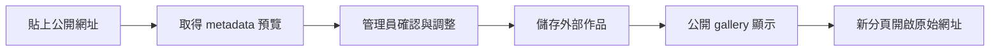

# 外部公開台本匯入流程（現況）

最後更新：2026-10-20（v0.7.1）

本功能用於把其他網站已公開的台本登錄到本站 gallery。本站只保存展示所需的
metadata、封面與作者／組織圖片快取；完整台本內容與閱讀頁仍由原始網站提供。

## 管理入口

登入工作室後，前往「設定 → 平台管理 → 外部公開台本」。管理員可以：

- 貼上外部公開台本網址並取得預覽；
- 取得或更新標題、摘要、封面、作者、作者介紹、組織與外部連結；
- 設定分類 tag、掛載日期、排序與發布狀態；
- 手動覆寫標題、摘要或封面；
- 重新抓取外部資料／照片；
- 編輯或移除已登錄的外部作品。

## 匯入流程

1. 從來源網址取得 canonical URL、來源網站、標題、摘要、作者與封面資訊。
2. 管理員在預覽結果中確認資料，必要時補上作者／組織連結或手動修改欄位。
3. 儲存後，本站建立外部作品資料，並以 `published`、`draft` 或 `hidden` 控制顯示狀態。
4. 公開卡片顯示本站保存的 metadata；點擊作品時以新分頁開啟 `sourceUrl`。

## 日期與圖片

- `mountedAt` 是本站掛載／顯示日期，可在管理介面手動指定；未指定時使用儲存時間。
- 外部來源沒有可用封面時，Google Drive／Docs 類來源可嘗試以文件第一頁產生展示封面。
- 作者與組織的社群頭像會在管理員取得或更新資料時快取到本站媒體儲存，不在每次公開頁載入時即時請求第三方服務。
- 公開頁透過 `/api/public-media/external/[id]` 提供外部作品封面，避免把不穩定的第三方圖片網址直接交給 gallery。

## 作者與組織頁

外部作品若有作者或組織名稱，公開卡片會連到：

- `/author/external/[name]`
- `/org/external/[name]`

這些頁面聚合本站已登錄的外部作品，並保留作者／組織的原始外部連結。

## API 與安全邊界

管理 API 位於 `/api/admin/external-public-scripts`，包含預覽、列出、建立、更新與刪除操作，
只允許管理員使用。外部匯入不會建立一般劇本本文，也不會替來源網站內容建立本站閱讀器副本。

本機 MCP 只可呼叫這組外部台本管理 API，使用 `X-MCP-Key` 驗證；它預設先回傳預覽，
必須在使用者明確同意後才可用 `confirm=true` 寫入。設定方式見
[`外部台本本機 MCP`](../architecture/local-external-script-mcp.md)。
