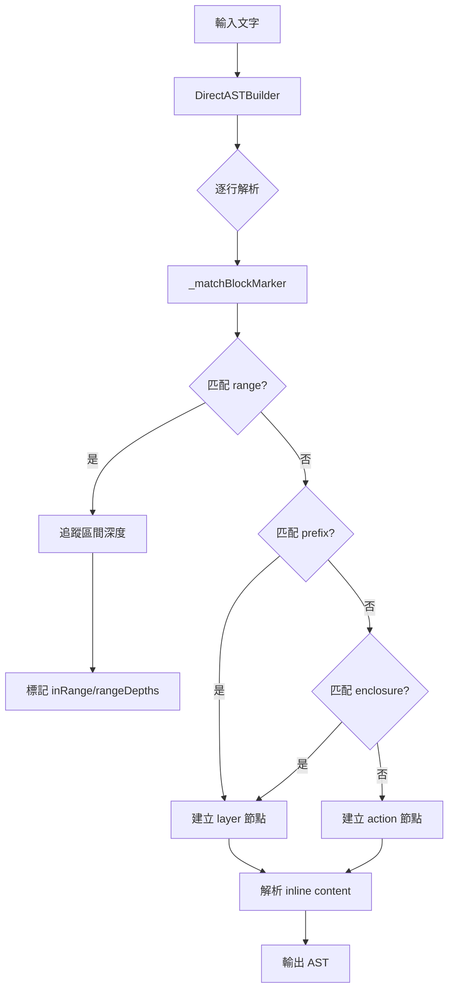

# Marker 設定與解析說明
最後更新：2026-11-20

## 編輯、預覽與儲存

1. 在工作室開啟「設定 → 自訂標記」，選擇要調整的主題。可直接在規則表修改名稱、匹配方式和輸出設定，也可開啟單條規則編輯。
2. 在「試寫原稿」輸入符合規則的文字，查看「網頁閱讀預覽」與「Word 成品」。欄位名稱、順序、寬度和對白排列可在「欄位版面」調整。
3. 從規則操作選單刪除規則後，可使用提示中的「復原刪除」。確認結果後按「儲存」，將草稿套用至主題。

「設定 → 外觀與閱讀」可預覽字型、字級、行距、標記提示、分欄和行底線。行底線會依目前的閱讀版面決定是否可用。

## 匯出製作台本 Word

在標記規則中設定 Word 輸出的類型、符號、字型、顏色與字重。回到編輯器，在下載選單選擇「製作台本（Word）」，確認這次匯出的各標記用途後下載 `.docx`。匯出視窗中的調整只套用於該次下載；要更新主題預設值，請回到「自訂標記」儲存。

## 分欄位顯示與同行同步（重要）

當你要讓不同欄位內容「同一列對齊」時，需同時滿足：

1. 使用分欄位顯示（V2 renderer 開啟）
2. 版面分組模式為 `marker_dialogue`
3. 同步區間 marker（例如 `<<< >>>`）開啟 `enableColumnGrouping=true`
4. 要同步的內容在同一個同步區間內

若任一條件不成立，內容仍會依原始行號顯示，不會同行同步。

## 匹配模式

### 1. 包圍模式 (enclosure)
**格式：** `[開始符號]內容[結束符號]`

```javascript
{
  id: 'sound-react',
  start: '|',
  end: '|',
  matchMode: 'enclosure'
}
```
**範例輸入：** `|嬌|`  
**說明：** 適用於單行，開始和結束符號包圍內容

---

### 2. 前綴模式 (prefix)
**格式：** `[前綴]內容`

```javascript
{
  id: 'sfx',
  start: '/sfx',
  matchMode: 'prefix'
}
```
**範例輸入：** `/sfx 門鈴聲`  
**說明：** 行首匹配前綴，後面的內容為 content

---

### 3. 區間模式 (range)
**格式：** 跨行區間，支援巢狀

```javascript
{
  id: 'music-1',
  start: '<cs>',
  end: '</cs>',
  matchMode: 'range',
  // 樣式可自訂，以下是幾種常見選項：
  style: { 
    // 選項 1：左側連接線（推薦）
    borderLeft: '2px solid #4CAF50',
    paddingLeft: '8px',
    
    // 選項 2：背景色
    // backgroundColor: 'rgba(100, 200, 100, 0.1)',
    
    // 選項 3：虛線框
    // borderLeft: '2px dashed #888',
  }
}
```
**範例輸入：**
```
<cs>口交開始，30s
  <cs>低速，10s
    對話內容
  </cs>低速轉中速
</cs>結束
```
**說明：** 
- 巢狀支援：同一組標記可多層嵌套
- 區間內容正常匹配所有其他規則
- 起訖行若含文字（如 `@1 開場`、`/@1 收尾`），文字會被保留並輸出
- 樣式完全自訂（連接線、背景色、邊框等）

---

### 4. 正規式模式 (regex)
**格式：** 自訂正規表達式

```javascript
{
  id: 'custom',
  regex: '^\\[sfx:(.*?)\\]',
  matchMode: 'regex'
}
```

---

## 解析流程



---

## 核心檔案

| 檔案 | 說明 |
|------|------|
| `packages/script-engine/src/parser/directASTBuilder.ts` | 解析器核心 |
| `apps/studio/src/constants/defaultMarkerRules.ts` | 預設 marker 設定 |
| `apps/studio/src/components/settings/marker/configs/ModeSelector.tsx` | 模式選擇器 UI |
| `apps/studio/src/components/settings/marker/MarkerOutputPreview.tsx` | 網頁與 Word 即時預覽 |
